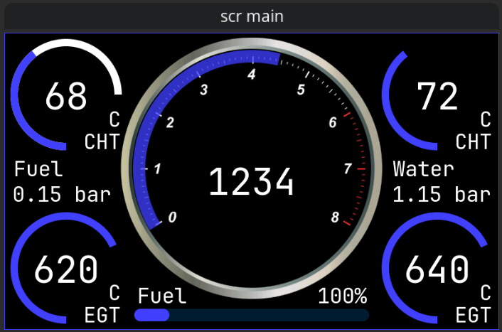

# Waveshare ESP32-S3 4.3" Dashboard

PlatformIO project for the Waveshare ESP32-S3 4.3" touch display, built on ESP-IDF, LVGL 9.4.0, and ESP-NOW.




## What It Does

This firmware brings up the LCD, GT911 touch panel, and LVGL UI, then listens for incoming sensor data over ESP-NOW and renders it on the dashboard.

The current generated UI contains one main LVGL screen (`SCREEN_ID_MAIN`) with RPM, fuel, pressure, CHT, and EGT widgets.

The project includes an EEZ Studio project. If you change layout or widgets there, export the generated files back into `src/ui/` and rebuild the firmware.

## Gauge And Data Handling Notes

The dashboard uses range checks, threshold bands, and update-rate limiting:

- Pressure and temperature channels are validated against plausibility windows before rendering.
- Temperature scale color bands are configured from threshold constants and clamped to each scale's runtime range.
- Fuel and water pressure low-band (yellow) thresholds ramp linearly with engine RPM instead of jumping.
- RPM and fuel level use fixed caution and danger thresholds.
- An animated dot travels along the RPM arc, smoothly interpolating toward the latest received RPM.
- UI refresh for different value groups is rate-limited on separate intervals to reduce redraw load and flicker.

The complete thresholds and rendering behavior are documented in [docs/architecture.md](docs/architecture.md).

Implementation is split across a few files:

- [src/app_config.h](src/app_config.h) — shared packet structs, sensor indexes, thresholds, and UI update intervals
- [src/display_setup.cpp](src/display_setup.cpp) — LCD/LVGL bring-up, GT911 touch, CH422G backlight control
- [src/espnow_rx.cpp](src/espnow_rx.cpp) — ESP-NOW receive handling and `updateUiFromEspNow()`
- [src/ui_scale_helpers.cpp](src/ui_scale_helpers.cpp) — scale color bands and the RPM dot animation
- [src/main.cpp](src/main.cpp) — `app_main()` boot sequence and memory diagnostics

## Key Pieces

- `src/main.cpp` starts the system and prints memory diagnostics
- `src/display_setup.cpp` / `.h` sets up the display, LVGL, touch, and backlight toggle
- `src/espnow_rx.cpp` / `.h` handles ESP-NOW receive and applies values to UI widgets
- `src/ui_scale_helpers.cpp` / `.h` configures gauge scale bands and the RPM dot indicator
- `src/app_config.h` holds shared constants and packet structs
- `src/ui/` contains generated EEZ Studio LVGL code
- `EEZ_studio-Boat_Dashboard-lvgl94/` contains the EEZ project files
- `docs/architecture.md` explains the runtime flow in more detail

At startup the firmware follows this order:

1. Initialize the display system (`initializeDisplaySystem()`: I2C, LCD/LVGL, CH422G backlight, UI init, touch)
2. Start the ESP-NOW receiver (`setupEspNowReceiver()`)

After that, the main loop polls touch input, runs `lv_timer_handler()`/`ui_tick()`, and calls `updateUiFromEspNow()`. The UI path applies RS485 readings for water pressure, fuel pressure, cylinder-head temperatures, and exhaust temperatures, and it applies fuel level, RPM, and bus voltage from the second ESP32 sender.

## Build And Flash

Run these commands from the directory containing `platformio.ini` (Linux):

```sh
pio run -e waveshare_lcd_4_3
pio run -e waveshare_lcd_4_3 -t upload
pio device monitor -e waveshare_lcd_4_3
```

The project uses Espressif32 platform 7.0.1 and ESP-IDF 6.0.1. The N16R8 board
definition is included in `boards/`; no global custom board installation is needed.
The application binary is
`.pio/build/waveshare_lcd_4_3/firmware.bin`.

PlatformIO detects the USB port automatically. To select a specific port, copy
`platformio.local.ini.example` to `platformio.local.ini` and set the local ports there.
The local file is ignored by Git. VS Code with the PlatformIO extension can also build,
upload, and monitor this environment.

## Build Troubleshooting

LVGL sources are discovered from the local component tree. No generated source list
from another computer is required. After moving or renaming the project, remove the
`.pio/build/waveshare_lcd_4_3/` directory and rebuild if CMake reports stale paths.

## Public Repository And Release Preparation

See [docs/public-release.md](docs/public-release.md) for the local audit findings,
publication checklist, and release artifact commands. Private credentials belong in
ignored local files, never in source files or release binaries.

The selected 16 MB partition table contains two OTA application slots. The dashboard
currently receives data over ESP-NOW; it does not yet download or install firmware
from GitHub Releases. Release hosting is preparation for that future implementation.

## License

The original dashboard application is licensed under the [MIT License](LICENSE).

## Third-party Licenses

Keep the bundled component license files when redistributing source or binaries.
The generated JetBrains Mono fonts use the [SIL Open Font License](licenses/JetBrainsMono-OFL.txt).
See [THIRD_PARTY.md](THIRD_PARTY.md) for component notices and outstanding licensing decisions.

## UI Workflow

When you edit the dashboard in EEZ Studio:

1. Open one of the `.eez-project` files under `EEZ_studio-Boat_Dashboard-lvgl94/`
2. Make your UI changes and export generated LVGL files
3. Copy/export those generated files into `src/ui/`
4. Rebuild and reflash the firmware

If the UI looks unchanged after an edit, the usual cause is that generated files were not copied into `src/ui/` before rebuilding.

## Image Format Tips

Recommended settings for dashboard background images:

- Use RGB565 for opaque images.
- Pre-scale each image to its final on-screen size before export.
- Avoid runtime zooming or scaling in LVGL for large images.

This matches the project display color format and helps reduce CPU usage.

## Code Overview

- `app_main()` in [src/main.cpp](src/main.cpp) starts the system: `initializeDisplaySystem()` then `setupEspNowReceiver()`, followed by the main loop
- `initializeDisplaySystem()` in [src/display_setup.cpp](src/display_setup.cpp) sets up the RGB display, LVGL, draw buffers, tick timer, CH422G backlight control, UI initialization, and touch
- `touchInitialize()` connects the GT911 touch controller to LVGL
- `setupEspNowReceiver()` in [src/espnow_rx.cpp](src/espnow_rx.cpp) starts the minimal Wi-Fi/ESP-NOW receiver path for incoming sensor packets
- `onEspNowReceive()` validates and stores the newest incoming sensor packet
- `updateUiFromEspNow()` applies RS485 and ESP32_2 values to dashboard widgets with per-group rate limiting
- `configureScaleBandsFromThresholds()` and friends in [src/ui_scale_helpers.cpp](src/ui_scale_helpers.cpp) configure gauge color bands and drive the animated RPM dot

For a more detailed beginner-friendly explanation, see [docs/architecture.md](docs/architecture.md).
